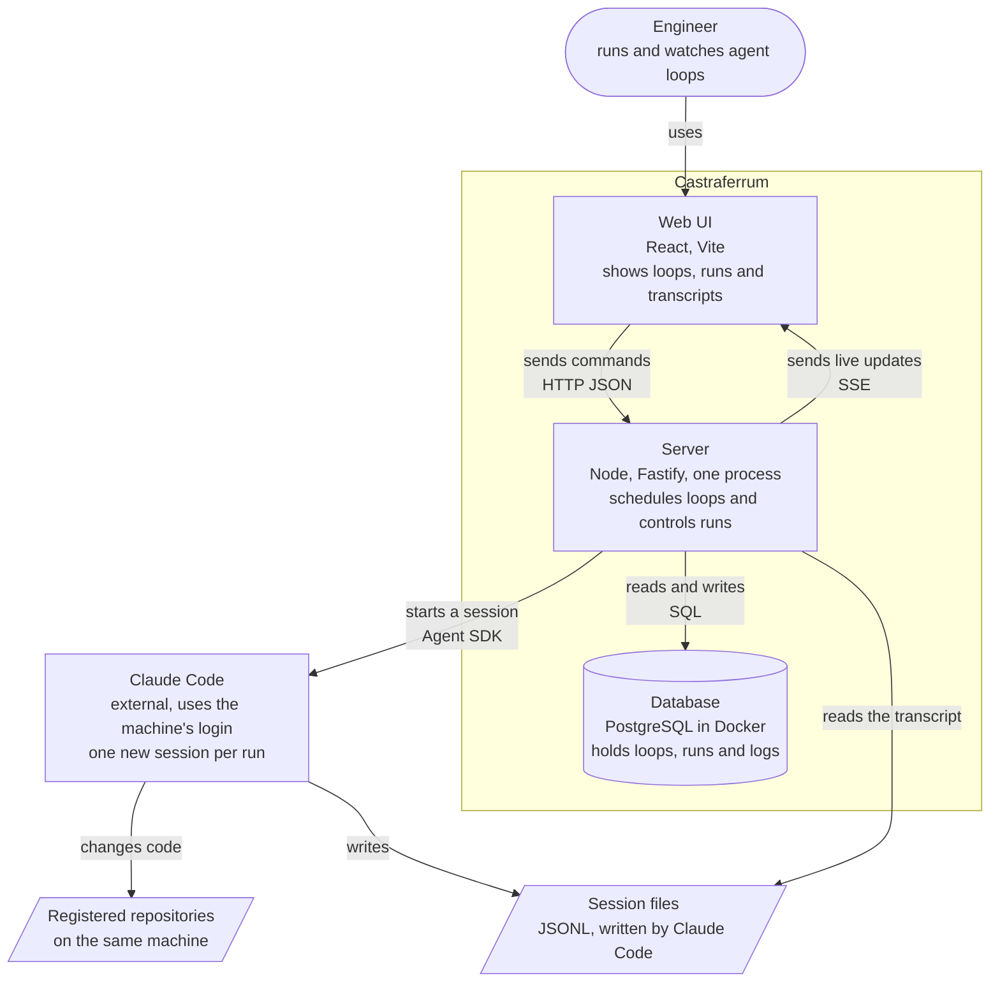
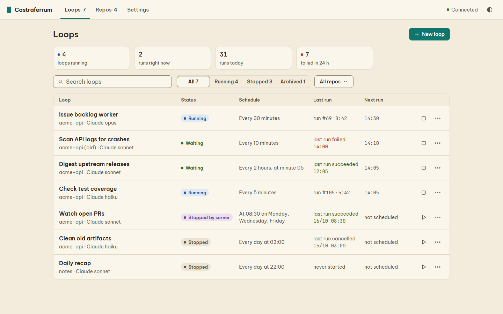
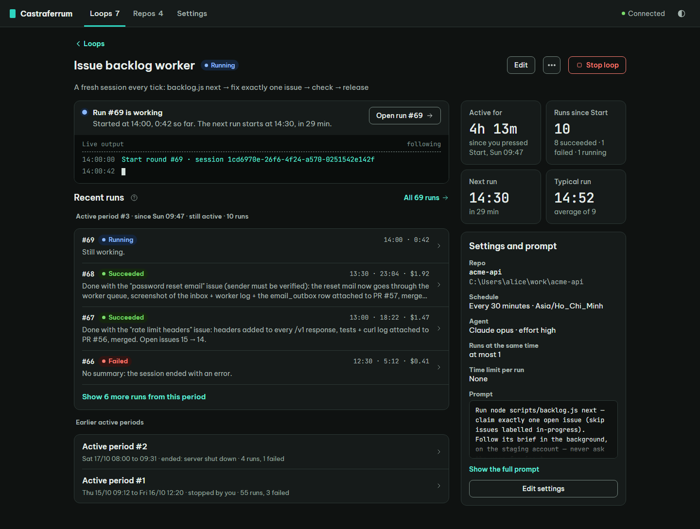

# Castraferrum

Castraferrum is a UI that runs, watches and manages agent loops. A loop is a prompt, a cron schedule and a
repository. Each time the schedule fires, one new Claude Code session starts in that repository.

## How it works



The engineer works in the Web UI, and the Server does the work. The Server keeps the schedule and the run history
in PostgreSQL. The Server fires each schedule by itself, so no browser needs to be open. For each run, the Server starts one new Claude
Code session in the registered repository, with the Claude Code login of the machine. The Server reads the session
file that Claude Code writes, so PostgreSQL holds no copy of the transcript. The components in the Server and the
full flow of a run are in [docs/ARCHITECTURE.md](docs/ARCHITECTURE.md).

## Screens





The screens follow the design system in [design/ds/](design/ds/) ([SYSTEM.md](design/ds/SYSTEM.md), the
design-system page `design/ds/index.html` and the approved preview `design/ds/preview/`); see
[design/README.md](design/README.md).

## Requirements

- Node 24 or newer (`node --version`).
- Docker (Docker Desktop on Windows and macOS) for PostgreSQL only.
- Claude Code installed and logged in on the same machine. The console uses that login; it never uses an
  `ANTHROPIC_API_KEY`.

## Quickstart

```bash
npm ci
docker compose up -d
npm run build
npm start
```

Then open <http://127.0.0.1:7070>. `npm ci` also downloads Chromium for the Playwright tests (about 150 MB the
first time). `docker compose up -d` starts Postgres on `127.0.0.1:55432` with the databases `loops` (real use)
and `loops_test` (tests). To serve on another port, set `LOOPS_PORT` before `npm start`:

```bash
LOOPS_PORT=7170 npm start      # PowerShell: $env:LOOPS_PORT = '7170'; npm start
```

The server does not start by itself: leave the `npm start` window open while you use the UI. The UI is served
from `dist/web`, so rerun `npm run build` after pulling new code. The first thing to do in the UI is register a
repository on the Repos page (**Add a repo** opens a folder picker), then create a loop that uses it.

## Configuration

Defaults work with no configuration. To change ports copy `.env.example` to `.env`; compose, the server, Vitest
and Playwright all read it.

| Variable | Default | Meaning |
|---|---|---|
| `LOOPS_PORT` | 7070 | API and UI port |
| `LOOPS_PG_PORT` | 55432 | Postgres port on the host |
| `LOOPS_E2E_PORT` | 7071 | Port of the e2e server |
| `DATABASE_URL` | derived from `LOOPS_PG_PORT` | Use when Postgres is elsewhere |
| `LOOPS_TEST_DATABASE_URL` | derived from `LOOPS_PG_PORT` | Test database |
| `LOOPS_COMPOSE_PROJECT` | `loop-console` | Docker Compose project name |
| `LOOPS_PG_CONTAINER` | `loop_console_pg` | Name of the Postgres container |
| `LOOPS_PG_VOLUME` | `loop_console_pg` | Name of the Postgres data volume (the default holds real loop history) |

`LOOPS_TEST_MODE=1` works only with a database whose name ends in `_test`. Several checkouts can run tests in
parallel on one container if each one sets its own `LOOPS_TEST_DATABASE_URL` and `LOOPS_E2E_PORT`.

## Scripts

| Script | What it does |
|---|---|
| `node scripts/logon-task.mjs [--console-dir <abs>] [--port 7070] [--task-name Castraferrum] [--out <file>]` | Prints Windows Task Scheduler XML that starts the console at log-on. With `--out` it writes the XML file and prints the one `schtasks /Create` line for you to run. The script never installs the task. |

## Documentation

- [docs/ARCHITECTURE.md](docs/ARCHITECTURE.md): layers, flows, persistence, tests.
- [docs/USE-CASES.md](docs/USE-CASES.md): the use cases.
- [design/README.md](design/README.md): the design system and how a UI change starts from it.
- [docs/API.md](docs/API.md): the HTTP surface.
- [docs/adr/](docs/adr/): decision records.
- [CONTRIBUTING.md](CONTRIBUTING.md): how to work on the code.
