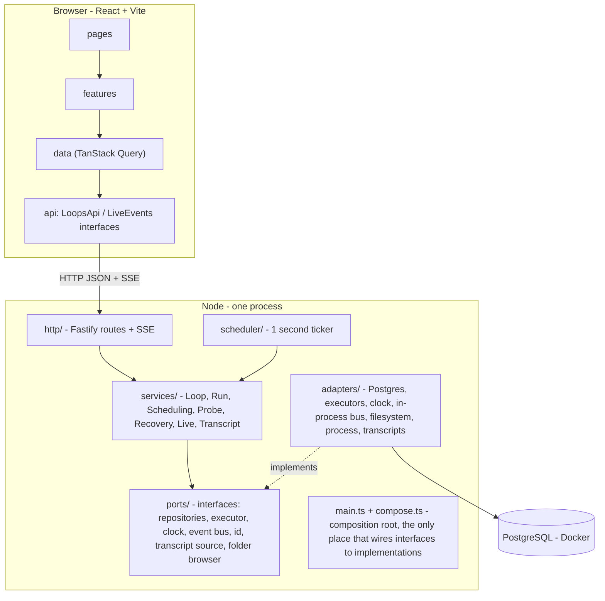
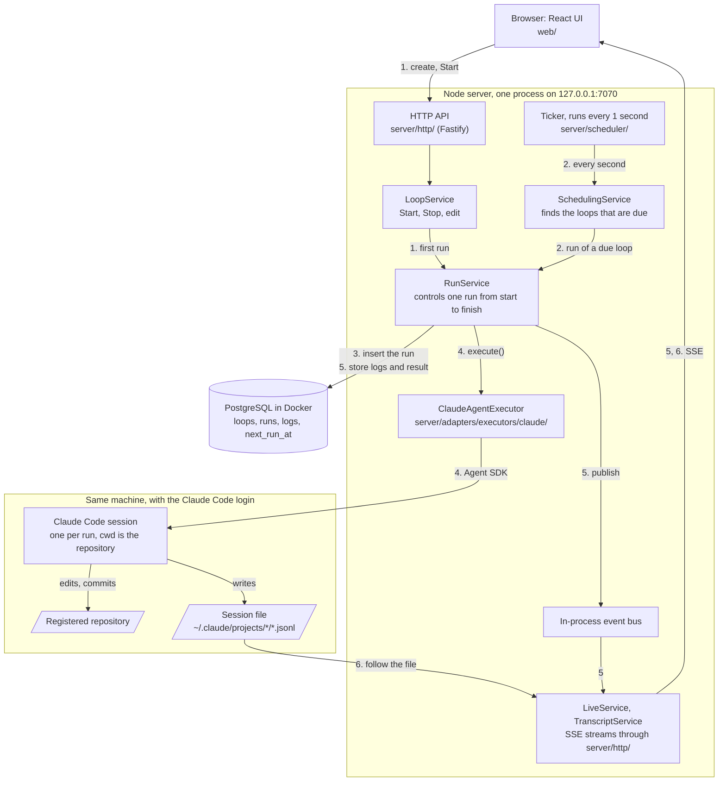
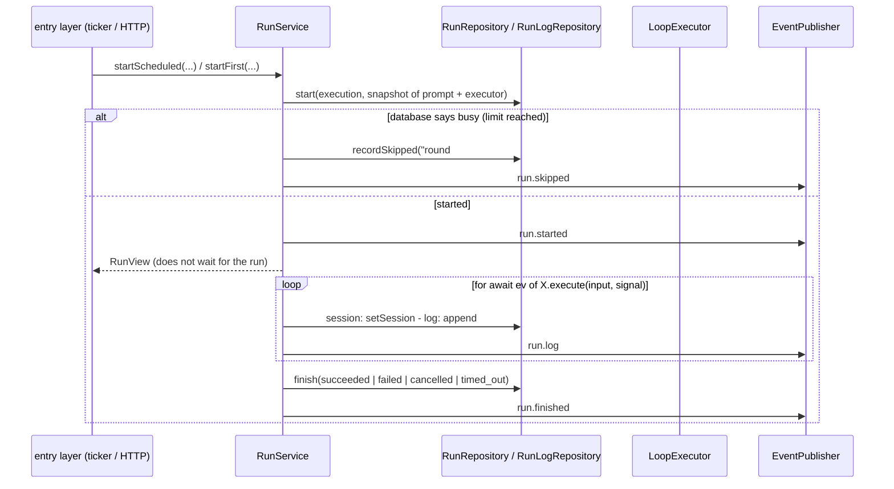

# Castraferrum - architecture

Castraferrum is a local web UI that runs and watches many agent loops. A loop is a prompt plus a cron schedule
plus a repository; each time it fires, one fresh Claude Code session starts in that repository (see
[ADR 0001](adr/0001-fresh-session-per-tick.md)). This document explains how the code is layered, how a run
flows through it, what is stored, and how it is tested. The use cases are in [USE-CASES.md](USE-CASES.md) and
the HTTP surface is in [API.md](API.md).

## The picture



Solid arrows are calls and only point downwards. No layer calls the layer above it; data goes up only as return
values (even streams: a service pulls events from an executor with an `AsyncIterable`, it never hands the
executor a callback to call back).

### The full flow

This diagram shows the components that take part in one run. Each number on an arrow is a step in this list:



1. The engineer creates a loop in the UI and presses Start. `LoopService` opens an execution (one Start-to-Stop
   span) and starts the first run.
2. Every second, the ticker calls `SchedulingService`. `SchedulingService` reads `next_run_at` from PostgreSQL,
   moves it forward and asks `RunService` for a run of each loop that is due.
3. `RunService` inserts the run. A database trigger rejects the insert when the loop is at `max_concurrent`, and
   `RunService` then records a `skipped` run. PostgreSQL holds this rule, so two ticks cannot both start a run.
4. `ClaudeAgentExecutor` starts Claude Code through the Agent SDK. The session works in the registered repository
   with the Claude Code login of the machine. The run ends when Claude Code exits.
5. `RunService` stores each log line and the final result in PostgreSQL and publishes an event for each change.
   `LiveService` sends those events to the browser over Server-Sent Events (SSE).
6. Claude Code writes its own session file. `TranscriptService` reads that file and streams it to the UI, so
   PostgreSQL holds no copy of the transcript.

## Technology

| Part | Choice | Why |
|---|---|---|
| Runtime | Node 24, plain process, no container for the app | The executor must reach the host's repositories and the Claude Code login |
| HTTP | Fastify 5 + TypeScript | `app.inject()` tests routes without a port |
| Validation and shared types | zod + `fastify-type-provider-zod` | One schema validates requests, encodes responses and types the UI (`shared/contracts`) |
| Database | PostgreSQL in Docker | Constraints (partial unique indexes, CHECK, a trigger) hold the invariants inside the database |
| DB access | Drizzle ORM + drizzle-kit | Schema in TypeScript, generated SQL migrations applied at startup; sits behind repository interfaces |
| Scheduling | Own 1 second ticker + `loops.next_run_at`; `croner` only as the pure "next run" function | Overlap protection in the database, tests with a fake clock, state visible with `SELECT` |
| Schedule sentences | Hand-written for the five builder shapes; `cronstrue` for the Advanced shape | Wording stays under our control |
| i18n | Hand-written `shared/i18n/en.ts` and `vi.ts` ([ADR 0003](adr/0003-hand-written-i18n.md)) | Two fixed languages do not need a library |
| Realtime | Server-Sent Events | One direction is enough; the browser reconnects by itself |
| UI | React 19, Vite, React Router, TanStack Query; CSS from `design/ds/tokens.css` and `design/ds/components.css` (the design system, `design/ds/SYSTEM.md`) | SSE events only invalidate the query cache; reusing the design system's CSS as it is makes the app match the approved preview pixel for pixel |
| Tests | Vitest, Playwright, dependency-cruiser | See "Testing" below |
| Not used | queue, Redis, DI container, monorepo tool, microservices | One process plus Postgres is enough |

Postgres 18 mounts its volume at `/var/lib/postgresql` (not `/data` as in 17 and below). The test database
`loops_test` is created by `pg-init/` the first time the volume is initialised. Versions are pinned in
`package.json` and `package-lock.json`; upgrading is one pull request with `npm run verify` green. Notable pins:
TypeScript stays on 6.x because dependency-cruiser reads `import type` through the TypeScript JS API, which
TypeScript 7 does not ship.

## Layers and the dependency rule

| Folder | Role | May import | Must not import |
|---|---|---|---|
| `shared/domain/` | types and pure rules: schedule (cron to builder, sentence, next runs), run state transitions, figures, domain errors | `shared/i18n` (plain text), pure libraries (croner, cronstrue) | every other folder |
| `shared/contracts/` | zod schemas of requests, responses, events, error codes | `shared/domain`, zod | `server/`, `web/` |
| `shared/i18n/` | UI texts | itself | everything else |
| `server/ports/` | interfaces a service needs: repositories, executor, clock, event bus, id, active-run registry, DB probe, transcript source, folder browser | `shared/domain` | services, http, adapters, other libraries |
| `server/services/` | use cases; every service is an interface plus a `Default...` class | `shared/domain`, `server/ports` | http, scheduler, adapters, `fastify`, `drizzle-orm`, `pg`, Node modules (go through a port) |
| `server/adapters/` | implementations of the ports: `postgres/`, `memory/` (test double), `executors/` (`claude/` is the only place that imports the Agent SDK), `fs/`, `process/` (runs a command with no shell), `transcripts/claude-jsonl/`, clock, event bus, ids, active runs | ports, shared, libraries | services, http |
| `server/http/`, `server/scheduler/` | entry layer: take a request or a tick, call a service through its interface, map domain to DTO and errors to HTTP codes | `shared/*`, interfaces in `server/services/contracts.ts` | adapters, ports, `Default...` classes |
| `server/main.ts`, `compose.ts`, `config.ts` | composition root and process (port, signals); environment | everything except `web/` | nobody imports `main.ts` |

Inside the service layer the direction is also one way: `LoopService` and `SchedulingService` call
`RunService`; `RunService` calls no service. Classes only know each other through the interfaces in
`contracts.ts`. There are no cycles anywhere.

`npm run arch` enforces the table with dependency-cruiser (mostly as allow-lists, so an unlisted npm package is a
violation too) plus `no-circular`. A rule that cannot be expressed as an import ("only `web/api/` may touch the
network") is a text scan in `scripts/arch-lib.mjs`. The folder `tests/arch-fixtures/` mimics the real tree with at
least one deliberately violating file per rule, each marked with a comment naming the rule; `npm run arch` prints
`dependency-cruiser: N violations` (must be 0) and `arch-fixtures: k/k violations caught`, and fails when a
declared violation is not caught, when an unexpected one appears, or when a rule has no violating file.
See [ADR 0002](adr/0002-ports-and-adapters.md) for the reasoning.

### Browser side

| Folder | Role | Must not import |
|---|---|---|
| `web/ui/` | design system: `web/ui/kit/` imports the two CSS files of `design/ds/` directly and holds thin React wrappers around the exact CSS classes; `web/ui/toast.tsx` holds the toast; knows no business logic and no i18n | every other `web/` folder |
| `web/prefs/` | language and light/dark (provider, `useT()`, localStorage, `data-theme` and `lang` on `<html>`), number and duration formatting | anything outside itself except `shared/i18n` and `shared/domain` |
| `web/app/` | app frame: router, frame, top navigation, tab bar, status banner | - |
| `web/api/` | `LoopsApi` and `LiveEvents` interfaces with the HTTP and SSE implementations; only shared contract types | `ui`, `data`, `features`, `pages` |
| `web/data/` | TanStack Query hooks and the live-event to cache bridge | `pages`, `features`, concrete `http-*` / `sse-*` files |
| `web/features/` | business components: loop table, form with schedule builder, detail screens, transcript | `pages`, concrete api files, direct `fetch` |
| `web/pages/` | features assembled per route | `web/api/*` |

Every `web/` folder is barred from `server/` and server libraries; nothing outside `web/api/` touches the
network. Component tests plug `FakeLoopsApi` and `FakeLiveEvents` into the same providers instead of mocking
`fetch`.

## Interfaces

### Services (what the entry layer calls, `server/services/contracts.ts`)

- `LoopService`: `list`, `get`, `create` (always Stopped), `update` (with `version`), `start`, `stop`,
  `duplicate`, `archive`, `restore`, `listExecutions`, `getExecution`, `executors`.
- `RunService`: `startFirst`, `startScheduled` (busy gives a skipped run), `cancel`, `expireOverdue`, `get`,
  `listByLoop`, `logs`.
- `ProbeService`: `get`, `save`, `remove` for the settings of a loop's probe, and `tick()`, which the background
  ticker calls every second.
- `SchedulingService.tick()` is called every second; `RecoveryService.recover()` once at startup;
  `HealthService.check()`; `LiveService` (`events`, `runLogs` as async iterables); `TranscriptService`
  (`page`, `follow`).
- Further services cover repos and the folder browser.

### Ports (what services call, `server/ports/`)

Repositories (`LoopRepository`, `ExecutionRepository`, `RunRepository`, `RunLogRepository`,
`HeartbeatRepository`, `RepoRepository`, `LoopProbeRepository`, `ClaimRepository`), `Clock`, `IdGenerator`, `DbProbe`,
`DirectoryProbe`, `FolderBrowser`, `ActiveRunRegistry`, `EventPublisher` and `EventSource`, `TranscriptSource`,
`CommandRunner` (runs a command with no shell, and kills a hung command with its whole process tree),
`ClaimGateway` (runs the claim and release commands of a probe row, `adapters/claims/`), and `LoopExecutor`.

Rules every repository follows (held by the contract tests):

- Ids are issued by the service (`IdGenerator`), never by the repository, so tests build deterministic data.
- `open` of an execution is one transaction: bump the counter, set the loop active, insert the execution; a
  violation of the one-open-execution index rolls back and returns `already_active`.
- `version` changes only on a configuration edit (and archive/restore). Start, Stop, the ticker's
  `advanceNextRun` and recovery do not change it, so they never raise a false edit conflict.
- `finish` only changes a run that is still `running`; whoever finishes first wins.
- The in-memory double enforces the same named constraints as Postgres, so service tests trust it.

### The executor contract

An executor is `{ kind, describe(), execute(input, signal) }` where `execute` returns an async iterable of
events: `session`, `log` and one final `result`. Every implementation passes the same suite
(`tests/contract/executor.contract.ts`):

- exactly one `session` before any other event (the Agent SDK reports it in the `system` init message, so a
  cancelled or timed-out run still has a session id);
- then zero or more `log` events, then exactly one `result`, or a thrown error;
- never throw synchronously (a bad configuration only fails on iteration);
- when the signal aborts (even before the call) the iterable ends within `describe().cancelWithinMs` and emits
  no `result` after the abort;
- one session id per run; no database access; no knowledge of services.

The one exception to "session first": a run that fails before the agent starts (the repo directory is
missing) emits an error `log` and a failed `result` without a session.

## Composition root

`compose.ts` exports `composeServer(options)`, the only function that connects interfaces to implementations.
`main.ts` reads configuration, calls it, listens on the port and handles shutdown. API tests call
`composeServer` too, so they run the real wiring and there is no second hand-wired copy. No DI framework: one
file shows every wire.

Startup order: open the database and apply migrations; take the instance lock (a Postgres advisory lock on a
dedicated connection, one database - one server); build the clock, bus, repositories, executors, services; run
recovery (before the ticker and before HTTP); build the HTTP app; then `startTicker()` and `listen`.
`startTicker()` starts the schedule ticker and the background ticker. The array `background` in `compose.ts`
lists the services of the background ticker.

Graceful shutdown: stop the tickers (wait for the running ticks; a hung probe adds at most its 30 second limit
and the 1 second kill grace), `app.close()` (a `preClose` hook aborts every
SSE stream, otherwise Fastify waits forever), abort every running run **without writing a result**, wait for
them to settle, write a last heartbeat, release the lock, close the database. Runs left `running` are handled by
the next startup exactly like a crash, only with an `endedAt` equal to the real shutdown time. Windows has no
real signal for a child process, so a parent opens an IPC channel and sends `{ type: 'shutdown' }`; Ctrl+C in a
console is SIGINT.

## Main flows

### Start and Stop

```
start(id):  executions.open(id, now, nextRunAt = nextRunAfter(cron, tz, now))   // one transaction
            runService.startFirst(id, execution.id)                             // first run begins now
stop(id):   executions.close(id, 'stopped', now)                                // one transaction, loop -> stopped
            for each running run: runService.cancel(run.id, 'cancelled')        // database changes immediately
            // close first, cancel second: a tick that sneaks in can no longer advance next_run_at
```

### The tick (every second, `SchedulingService.tick`)

```
every 10 seconds: heartbeat.beat(now)                  // so recovery can tell when the server stopped
runService.expireOverdue()                             // runs past deadline_at are cancelled as timed_out
for loop in loops.findDue(now, 50):
    next = nextRunAfter(loop.cron, loop.timezone, now) // computed from NOW: a laptop waking up runs once, no backlog
    if !loops.advanceNextRun(loop.id, loop.nextRunAt, next): continue   // compare-and-set; edited or stopped meanwhile
    runService.startScheduled(loop.id, loop.openExecutionId, loop.nextRunAt)
```

A run's deadline (`deadline_at = started_at + timeoutSec`) lives in the database and is checked on the tick;
there is no `setTimeout`, so winding the test clock forward is enough to time a run out.

### The probe tick (every second, `ProbeService.tick`)

A loop with a row in `loop_probes` is a probe loop ([ADR 0004](adr/0004-console-owns-the-goal-life-cycle.md)).
Start gives it `next_run_at` null and no first run, so `findDue` skips it. A loop with no row is not changed.

```
if the previous tick has not finished: return           // no overlap
for each open run_claims row whose run is not running:  // also of a stopped loop; a row with no run counts
    release (a failed command keeps the row, next try 60 s later), then close
for each loop_probes row, at the same time, each caught alone:
    skip a loop that is not active, or is archived
    skip until 60 s after last_probe_at, or until a run ended after last_probe_at
    skip a loop with no free lane                       // running runs >= max_concurrent
    commands.run({ argv, cwd: repo.path, timeoutMs: 30000 }), then parseProbeLine
    probes.record(state, lastLine, the tick's now)      // a run that ends during the call gives a new probe
    for each task of a take, until the free lanes end:
        claims.open                                     // `taken` goes to the next task
        claimGateway.claim                              // a refusal closes the row and goes to the next task
        runService.startClaimed                         // a skipped run gives an excused release and a close
```

`server/scheduler/background-ticker.ts` keeps one in-flight promise for each service, and a busy service skips a
beat. So a hung probe holds back its own service for at most 31 seconds, and it cannot hold back the schedule
tick, which has its own ticker. Exit 0 with a valid line sets the state of the action. A bad exit, a time-out or
a bad line sets `probe_failed`.

The order `open`, `claim`, run means that a claim on a task always has its row, so a claim cannot outlive its run. The
close reason is `run <status>[ <end word>]`. A release is excused for `interrupted`, `skipped`, a row with no run and
`RESOURCE_DOWN`, because none of them is a failure of the task. Each release carries `--if-claimed`, because a plain
release reopens a closed issue. `RunService` writes the run-end signal of the final text to `end_result` and `end_pr`.

### One run (`RunService`)



- **Cancellation writes the database first.** `cancel`, `stop` and `expireOverdue` signal the executor through
  `ActiveRunRegistry.abort`, but `RunService` immediately writes the log line and `finish(cancelled | timed_out)`
  without waiting for the executor. A late "done" from an executor that ignored the signal cannot overwrite it
  (`finish` is first-wins). Only the code path that really changed the run publishes `run.finished`.
- **Stop between tick and run:** the controller is registered right after `runs.start`, then the execution is
  checked; if it already closed, the run is cancelled at once without calling the executor.
- **Executor errors:** a failed `result` or a thrown error makes the run `failed` (with an error log line); an
  executor that ends without a result also fails; an unregistered executor kind fails. The loop and the
  execution are untouched.
- **Overlap protection is in the database.** A trigger takes a row lock on the loop and counts `running` runs;
  when the count reaches `loops.max_concurrent` the insert is rejected and the service records a `skipped` run.
  Two ticks, or a tick and the Start run, can never both win. A similar partial unique index allows only one
  open execution per loop.
- **A claimed run** (trigger `probe`, spec 2.7) holds the lowest free slot of its loop, from 0, and `runs.slot` stores it.
  Its env is `CASTRAFERRUM_SLOT` plus the `lane_env` of the probe with `{slot}` and `{port}` filled in. The executor
  spreads that env over its base env and then drops `ANTHROPIC_API_KEY`. The env is not stored. The prompt snapshot is the
  prompt line, a blank line, and the loop prompt. A run with no probe has no slot, no extra env and the plain prompt.
  - Prompt line: `[Castraferrum] The console claimed task <key> for this run (action <take or plan>). Do not run next or claim. Do this task only.`
  - Resume message: `[Castraferrum] The usage limit has reset. Continue the same task from where you stopped.`

### Startup recovery (`RecoveryService`, before the ticker and HTTP)

`t = heartbeat.last() ?? now`. Every `running` run becomes `interrupted` (its executor lived in the dead
process); its duration is measured up to `t`. Every open execution closes as `server_down` at `max(t,
startedAt)`, which is within 10 seconds of the real stop. Then all loops are set to Stopped and a heartbeat is
written. No loop restarts by itself: running again is always a person pressing Start.

### Parallel runs

`max_concurrent` (1 to 10) is the number of simultaneous `running` runs a loop may have. A tick at the limit is
skipped with the list of runs still going. Lowering the limit never cancels running runs; Stop cancels all.

## The Claude executor

`ClaudeAgentExecutor` (kind `claude`) wraps `query()` from the Agent SDK. Per run it uses the loop's repo as
`cwd`, the configured model and effort, the `claude_code` system prompt preset, full permissions, and the
environment minus `ANTHROPIC_API_KEY` (the login is used, not a key). It does not understand the agent's work:
it only logs lifecycle lines (start with session id, finish with state and cost) and records the final text as
the summary and the SDK's cost. Tool calls and thoughts stay in Claude Code's own transcript.

### A run ends when Claude Code exits, not at the first result

The first `result` message is not the end of a run. When the agent starts a background command and ends its
turn, Claude Code keeps the process alive, finishes the background task, wakes the agent with a notification and
runs another turn before it exits (measured up to 660 seconds). So the executor feeds the SDK a streaming input
(a queue of user messages, first the prompt), reads messages until the process exits on its own, and tracks the
set of background tasks from `system/background_tasks_changed` events (the `ambient` ones are ignored). It
closes the input only when it gets a successful `result` while that set is empty; a set that becomes empty while
idle schedules a 60 second settle timer that a new turn cancels.

If background tasks are still alive more than 30 minutes after the last result, the executor calls `stopTask` for
each (without awaiting it: `stopTask` hangs once the input is closed). Claude Code stops the tasks but does not
wake the agent, so the agent would never get a turn to tidy up. The executor therefore sends exactly one cleanup
message through the input, only after every `stopTask` finished and the agent is idle (if a new turn started
first, that turn is the cleanup turn). The wording, quoted verbatim by a unit test that re-reads this file, is:

> [Castraferrum] This run has waited for background tasks for more than 30 minutes since your last reply, so the
> console stopped these tasks: <description 1>, <description 2>. This is the last turn of the run: tidy up the
> unfinished work (record the state so the next run can continue), do not start new background tasks, then reply
> briefly with what you did.

From then on the input closes only at the `result` of the cleanup turn (the settle timer is gone); if that turn
starts new background tasks they are stopped first. Limits: the cleanup turn has 10 minutes from sending (or
from its own start when Claude Code woke the agent), and the process has 120 seconds after the input closes (or
after a `stopTask` that never finishes) before the abort controller kills it. The run still ends `failed` with
"Waited more than 30 minutes for background tasks - stopped: ...", while its summary and cost come from the
cleanup answer. The four time limits are constructor options so tests can shrink them.

Facts measured on Claude Code 2.1.x with Agent SDK 0.3.x that this design depends on:

- `total_cost_usd` is cumulative across the turns of one `query()`; take the last value, do not add them.
- A transcript whose last two lines are `last-prompt` and `cost-state` belongs to a process that exited cleanly;
  a session closed mid-flight lacks them. Tests use this as an oracle.
- `session_state_changed idle` fires after every turn, even with background tasks alive, so it cannot signal the
  end of a run.
- `abort()` with a live background task makes the iterator throw "Operation aborted" about 7 seconds later and
  can leave the task's child processes alive on Windows; `stopTask` cleans the whole process tree.
- The SDK hooks `SessionStart` and `SessionEnd` do not fire in a one-shot `query()`.

## Transcript of a run

The UI shows what Claude did by tailing the JSONL file Claude Code itself writes
([ADR 0001](adr/0001-fresh-session-per-tick.md) explains why runs are separate sessions; the transcript is read,
never copied into Postgres).

### Claude Code transcript layout

- Location: `<CLAUDE_CONFIG_DIR or ~/.claude>/projects/<folder derived from cwd>/<session_id>.jsonl`. The folder
  name is not reproducible from the cwd: the same directory produced `...repo-atlas-...` from `claude -p` and
  `...repo-Atlas-...` from the SDK. So the file is found by scanning `projects/*` for the session id, and the
  location is cached in memory. Changing `CLAUDE_CONFIG_DIR` loses the login.
- A short 16 second run is about 41 lines and 400 KB, of which only four are conversation lines (`user` prompt,
  `assistant` tool use, `user` tool result, `assistant` text). The rest are internal types: `attachment` (lines up
  to 75 KB), `api-request-*`, `queue-operation`, `last-prompt`, `ai-title`, `system`, and `cost-state` at the end.
  Over 46 real files, `assistant` and `user` lines are about a third of all lines; the longest line was 1.77 MB.
- Each `thinking`, `tool_use` and `text` block is its own `assistant` line; the line's `type` key comes after
  `message`, so the type cannot be read by looking at the start of the line.
- Claude writes the file 0.1 to 0.7 seconds after it emits a message. `fs.watch` on Windows delivered 20 of 20
  appends with a 1 ms average delay; polling `stat` every 100 ms averaged 64 ms.
- Conversation entries are sparse near the end of big files: the last 256 KB of a 71 MB file held 3 entries, the
  last 4 MB held 36 to 75; parsing 4 MB takes 10 to 17 ms. The SDK's own `getSessionMessages` on that file took
  253 ms, grew RSS by 184 MB and returned 3 messages, so it is not used.
- **Empty thinking.** Most `thinking` blocks are `{"thinking":"","signature":"..."}`: text is empty, only the
  signature remains. Of 5072 thinking blocks on one machine only 833 (16 percent) had text, all from opus, fable
  or sonnet in interactive sessions; haiku had none, and none of 36 blocks from SDK loop runs. The UI shows a
  "Thinking" row with an explanatory note rather than hiding it.
- Subagent transcripts live at `<projectDir>/<session_id>/subagents/agent-<id>.jsonl` with a `.meta.json`.

### Reading and following

```
browser (one stream per tab)                  server                                   disk
GET /api/runs/:id/transcript?before=N  -> TranscriptService.page -> runs.findById -> sessionId
                                          -> TranscriptSource.locate(sessionId)  -> scan projects/*/<id>.jsonl (cached)
                                          -> readBack(ref, before, 50 entries / 4 MB) -> read backwards in 256 KB chunks
GET /api/runs/:id/transcript/stream (SSE) -> TranscriptService.follow
    1. subscribe to run.finished of this run         (subscribe BEFORE reading)
    2. no cursor: snapshot = readBack(null); with a cursor: skip the snapshot
    3. file not there yet: emit "missing", retry every 500 ms (run already done: missing + ended)
    4. TranscriptSource.follow(ref, end): fs.watch + 50 ms debounce + 500 ms stat   -> entries { entries, end }
    5. run.finished: wait 1 s, final readForward, emit ended { status }, close
```

- Pages are by entry count (at least 50) with a byte budget (4 MB); the cursor is a byte offset; the browser
  loads older pages as the user scrolls up and the DOM has no cap. A page never reads the whole file.
- The server sends text verbatim and untruncated; it only drops internal line kinds. Folding long tool results is
  the UI's job.
- Streams share no state: two tabs are two `follow` calls, each with its own watcher. Reconnecting sends
  `Last-Event-ID` = the byte offset of the last entry received.
- Transcript streams are aborted in `preClose` like log streams.
- Nothing about transcripts is stored in Postgres: no table, no column, no path.

## Folder browsing for repo registration

A browser cannot reveal the absolute path of a folder a user picks, so the server lists directories. The port
`FolderBrowser` has one real adapter (`NodeFolderBrowser`) that is the only place knowing path rules per
operating system: it takes the platform and a filesystem as injected values and uses `path.win32` or
`path.posix` accordingly. A `MemoryFolderFs` (an in-RAM machine: operating system, home, known folders, tree,
forbidden directories, symlinks) lets unit tests run the macOS and Linux rules on Windows and lets test mode
swap the whole machine.

- Windows: the real locations of Desktop, Documents and Downloads are asked once from PowerShell (a Known Folder
  can live inside OneDrive under a localised name); roots are the drive letters. Hidden or noisy entries are
  filtered (`$...`, `AppData`, old junctions such as `Application Data`, system folders at the drive root).
- macOS: roots are the boot volume and `/Volumes`; `~/Library` and Unix folders at `/` are filtered; a directory
  that exists but cannot be listed (TCC blocks Desktop, Documents, Downloads until allowed) answers 200 with
  `unreadable: denied`.
- Equality of two paths is case-insensitive on Windows and macOS. The UI never joins or splits paths itself; it
  uses `parent`, `crumbs` and `path` from the server.

## Persistence (PostgreSQL)

Tables (schema in `server/adapters/postgres/schema.ts`; `npm run db:generate` writes SQL to `server/adapters/postgres/migrations/`, which
is committed and applied at startup):

| Table | Holds | Key constraints |
|---|---|---|
| `repos` | registered repositories: id, name, path | unique lower(name); unique path (real path at registration) |
| `loops` | configuration, status, `next_run_at`, counters (`run_counter`, `execution_counter`), `version`, `max_concurrent`, `timeout_sec` (null = no limit), `archived_at` | unique live name; `archived_at` only when stopped; `next_run_at` only when active; FK to `repos` |
| `loop_executions` | one Start-to-Stop span: `seq`, `started_at`, `ended_at`, `end_reason` (`stopped` or `server_down`) | unique (loop, seq); at most one open per loop |
| `runs` | one firing: `iteration`, `trigger` (`start`, `schedule` or `probe`), `status`, `skip_reason`, timestamps, `deadline_at`, `duration_ms`, prompt and executor snapshot, `summary`, `error`, `cost_usd`, `session_id`, `task_key`, `slot`, `end_result`, `end_pr` | trigger `runs_max_concurrent_per_loop` (lock the loop row, count `running`, reject at `max_concurrent`); unique (loop, iteration) |
| `run_logs` | lines of a run: `seq`, `at`, `level`, `message`, `data` | primary key (run, seq) |
| `run_claims` | the claim of a task for one run: `task_key`, `run_id` (no FK: the row comes before the run), `opened_at`, `closed_at`, `close_reason` | primary key `id`; FK to `loops`; partial unique index: one open row for each `loop_id` and `task_key` |
| `loop_probes` | the probe of a loop: argv commands (`command`, `claim`, `release`), `resources`, lane settings, `restart_policy`, `state`, `last_line`, `last_probe_at` | primary key `loop_id`; FK to `loops` |
| `server_heartbeat` | a single row written every 10 seconds | `id` is a fixed boolean |

Run states: `running`, `succeeded`, `failed`, `cancelled`, `timed_out`, `interrupted`, `skipped`.

`RunRepository.start` is one transaction: bump `loops.run_counter`, insert the `running` run with the new
`iteration`; a rejection by the trigger rolls back (the counter does not move) and returns `busy` with the runs
now going. Figures per execution are one aggregate query with `count(*) FILTER (...)`; "running for" is
`coalesce(ended_at, now) - started_at`. The session ids of an execution:
`SELECT session_id FROM runs WHERE execution_id = $1 AND session_id IS NOT NULL ORDER BY started_at`.

## Live events (SSE)

- `GET /api/events` carries state events (`loop.created`, `loop.updated`, `execution.started`, `execution.ended`,
  `run.started`, `run.finished`, `run.skipped`); the UI turns them into query-cache invalidations. The stream
  does not replay missed events: after a reconnect the UI reloads everything, which is cheaper and simpler.
- `GET /api/runs/:id/logs/stream` subscribes first, replays stored lines after `after`, then pushes new ones,
  deduplicating by `seq`. It ends with `end` when the run finishes.
- The in-process bus is enough because there is one process. Moving executors out later would swap the adapter
  for Postgres `LISTEN/NOTIFY` without touching services.
- UI side: `SseLiveEvents` owns the connection and, on error, closes the `EventSource` itself (the browser's own
  retry would hide the attempt number) and retries after 1, 2, 4, 8 seconds, capped at 8. State is
  `connecting | open | down`. Going from `down` to `open` invalidates every query. The database lamp follows
  `/api/health` every 5 seconds. Browsers hide `:ping` comments from JavaScript, so a hung server whose TCP
  connection is still open is not detected; a dead server drops TCP and is noticed at once.

## Testing

| Layer | Tool | Real or fake | What it proves |
|---|---|---|---|
| Domain | Vitest | pure | schedule builder round trip, sentences, next runs (time zones, `*/7`, day 31), state transitions, figures |
| Service | Vitest, `server/services/*.test.ts` with `tests/support/service-kit.ts` | in-memory repositories, a clock that only moves when the test winds it, a scripted executor | the logic of each use case: Start, Stop, skip on overlap, timeout, failed run keeps the execution open, restart, wake-up runs once, edit conflict |
| Repository contract | Vitest | one suite run on `memory/` and `postgres/` | the double behaves like the database; `npm run test:contract` prints `memory: N passed, postgres: N passed` and fails when the two differ |
| Executor contract | Vitest, real time | mock and Claude (fake `query`; real Claude with `LC_REAL_CLAUDE=1`) | swapping executors cannot break `RunService`; session first; stop within `cancelWithinMs` |
| API | Vitest + `app.inject()` (SSE: real listen + `fetch`) | real `composeServer` + Postgres `loops_test` | status codes, validation, error codes, SSE, test-only routes, graceful shutdown and restart, instance lock; `tests/api/api-surface.test.ts` reads [API.md](API.md) |
| Process smoke | `scripts/api-smoke.mjs` | the real `server/main.ts`, killed and restarted | the whole life cycle over HTTP, each step checked with `SELECT` |
| Component and pure UI logic | Vitest | `FakeLoopsApi` | form logic is split into pure functions tested in Node; browser behaviour is covered by e2e and screenshots |
| i18n | Vitest | pure | `en` and `vi` have the same keys, no empty strings |
| End to end | Playwright | everything real: browser, build, Fastify, Postgres; a mock executor and a windable clock; one test opens real Claude (haiku, low effort) in a `lc-real-claude-*` directory | every use case, tests tagged `@UC-NN` |
| Visual | Playwright project `visual` + pixelmatch per region | real, with a fixed clock | each approved reference state against the real screen, per-region pixel ratio under a threshold |
| Architecture | dependency-cruiser + `tests/arch-fixtures/` | - | the one-way layering and the interface rules |

**Test mode** (`LOOPS_TEST_MODE=1`, only with a database whose name ends in `_test`): `OffsetClock` (real time
plus an offset moved through `POST /api/__test/clock`), `POST /api/__test/reset` empties the tables between
tests. E2E winds the clock so a tick arrives at once instead of after a real minute; real time still passes, so
durations stay honest. A fake Claude (`lc-fake-claude-*` directories with a `[soak:N]` prompt) goes through the
real `ClaudeAgentExecutor` for the parallel-run use case.

**Ratchet.** `npm run uc-coverage` reads the `UC-NN` IDs from [USE-CASES.md](USE-CASES.md) and counts those with
at least one green e2e test (skipped, red or flaky do not count) from `reports/e2e.json`; `--min k` exits 1 when
the count falls below `k`.

**`npm run verify`** is the one command every change must pass: typecheck, language scan baseline, `arch`,
`ratchets -- --base main`, unit, contract, API (these run one after another because contract and API share `loops_test`), `api-smoke`,
build, e2e, and `uc-coverage --min 32`. E2E starts its own server on `127.0.0.1:7071` from the build so it does
not touch the one in use on 7070, and tests that kill the server or cut Postgres use
`tests/support/server-process.ts`: a real `server/main.ts` on a free port with a private database and a TCP proxy
in front of Postgres.

## Ports and commands

| | |
|---|---|
| API and UI (built) | `127.0.0.1:7070` (`LOOPS_PORT`) |
| Vite dev server | `127.0.0.1:5180`, proxying `/api` to 7070 |
| E2E server | `127.0.0.1:7071` (`LOOPS_E2E_PORT`) |
| Postgres (Docker project `loop-console`) | host `127.0.0.1:55432` (`LOOPS_PG_PORT`), databases `loops` and `loops_test`, volume `loop_console_pg` |

## Decisions

The decision records that matter most have their own files in [adr/](adr/). The remaining ones, in short:

| Decision | Reason |
|---|---|
| Schedule lives in the database (`next_run_at`) plus a 1 second ticker, not an in-memory cron | overlap protection in the database, testable with a wound clock, inspectable with `SELECT` |
| No queue | one process, Postgres holds the state, the interfaces leave room for a worker later |
| Deadlines are checked on the tick, no `setTimeout` | one time source (`Clock`) for everything |
| SSE, not WebSocket | one direction is enough |
| Smallest schedule unit is a minute | enough for agent loops and avoids burning money |
| An execution entity (Start to Stop) groups runs, and every run stores its session id | measures how long a loop has run and groups session ids for analysis, cancelled runs included |
| Restart closes executions as `server_down` at the last heartbeat and stops every loop | running again must be a person's choice; the heartbeat bounds the error to 10 seconds |
| Only Start and Stop; Stop cancels running runs | simplicity: no pause or resume, no one-off runs |
| Cancellation writes the database first, signals second | Stop is `cancelled` within 5 seconds regardless of the executor |
| Composition root split in two (`compose.ts`, `main.ts`) | API tests must run the real wiring without importing `main.ts` |
| Server runs TypeScript directly with `tsx` | Vitest, Vite and the server read the same sources; migrations sit next to them |
| DTOs are zod codecs in `shared/contracts` | one schema validates, encodes and types; no hand-written Date mappers |
| An interrupted run keeps the duration up to the last heartbeat | the figure is when the run really stopped, never negative |
| Transcript by tailing the JSONL file, no hybrid with the SDK stream | the console is a viewer and keeps no copy; measured delay fits the 2 second budget |
| Unlimited transcript streams, one watcher per tab | keep it simple; two tabs show both |
| The server sends transcript text verbatim | the owner wants everything, thinking included |
| The per-loop run limit is a database trigger | a unique index only expresses N = 1; raw SQL inserts are blocked too; lowering N touches no running run |
